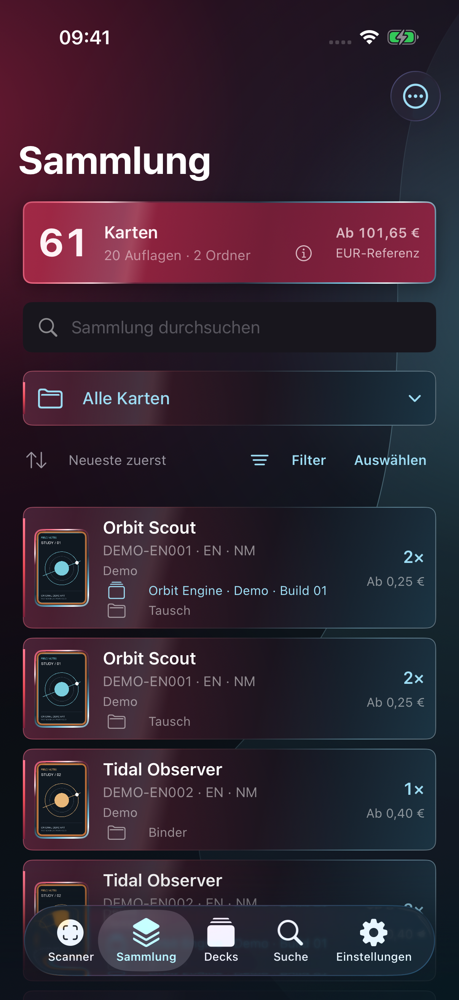
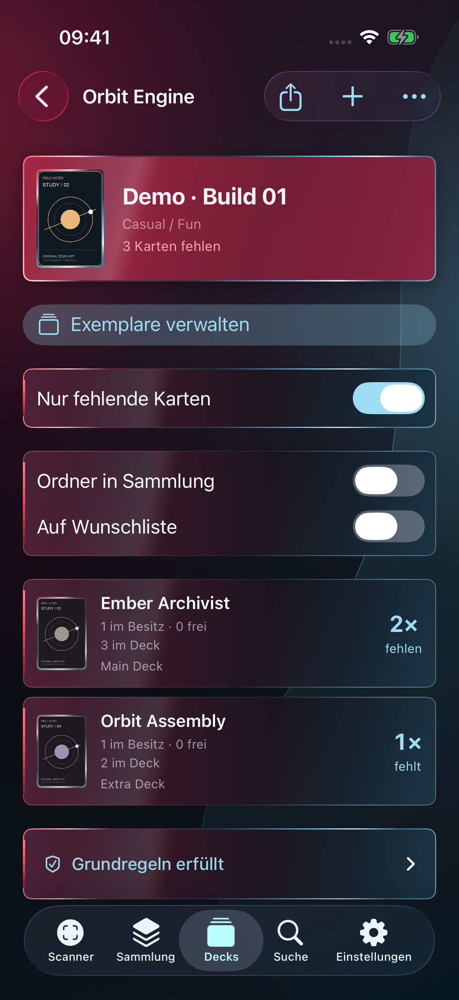

# YGO Scanner

Eine native iPhone-App, mit der ich meine physische Kartensammlung erfasse, Auflagen auseinanderhalte und Decks mit meinem tatsächlichen Bestand abgleiche.

**Persönliches Projekt von [Hallaka01](https://github.com/Hallaka01)** · SwiftUI · SwiftData · AVFoundation · Vision · iOS 17+

Dieses Repository ist die öffentliche Projektpräsentation. Es enthält echte Screenshots eines isolierten Demo-Stands und ausgewählte, ausführbare Codeauszüge. Der vollständige App-Code und meine persönlichen Sammlungsdaten bleiben privat. Das Projekt wird KI-unterstützt entwickelt.

## Ein Blick in die App

| Sammlung | Deckplanung | Fehlende Exemplare |
| :---: | :---: | :---: |
|  |  |  |

Alle gezeigten Karten, Texte, Besitzmengen und Preiswerte sind erfunden. Die Grafiken wurden eigens für diese Präsentation gestaltet. Die Screenshots zeigen die tatsächlichen SwiftUI-Ansichten der App, keine nachgebauten Web-Mockups. [Details zur Demo und Bildherkunft](docs/SCREENSHOTS.md)

Weitere Ansichten: [Kartendetails](assets/screenshots/03-card-detail.png) · [Detail eines Scan-Entwurfs](assets/screenshots/05-scan-detail.png)

## Was die App löst

- **Scannen ohne Doppelzählung:** Die Kamera liest den achtstelligen Kartenpasscode. Mehrere unterschiedliche Kamerabilder müssen denselben Treffer bestätigen; ein kurzer Erkennungsaussetzer erzeugt kein zusätzliches Exemplar.
- **Auflagen bewusst erfassen:** Karten-ID und Druckvariante sind unterschiedliche Informationen. Set-Code, Seltenheit, Sprache und Zustand bleiben getrennt; mehrdeutige Treffer müssen bestätigt werden.
- **Erst sammeln, dann übernehmen:** Scans landen zunächst in einem lokal gespeicherten Entwurfsstapel. Erst ein ausdrücklicher Transfer verändert Sammlung oder Deck.
- **Physischer Bestand statt bloßer Listen:** Jedes Exemplar lässt sich einem Ordner und exklusiv einem Deck zuordnen. Die App unterscheidet Gesamtbesitz, freie Exemplare und bereits anderweitig belegte Karten.
- **Deckbedarf sichtbar machen:** Main, Extra und Side werden gemeinsam gezählt. Fehlmengen erscheinen als dynamische Bedarfsliste und schrumpfen, wenn passende Exemplare hinzukommen.
- **Daten mitnehmen:** YDK für Deckrezepte, XML für Auswertungen und JSON für die Sicherung von Sammlung und Decks.

## Technische Entscheidungen

### Native Kamera und nachvollziehbare Erkennung

AVFoundation steuert die Kamera; Vision verarbeitet einen begrenzten Bildausschnitt. OCR-Auswertung, zeitliche Bestätigung und Wiedererkennung sind separate Schritte. So lassen sich problematische Fälle ohne Kamera-Hardware testen.

→ [Scanner-Erkennung und Bestätigung](Examples/ScannerCore/ScanRecognition.swift)

### Bestand und Deckrezept getrennt modellieren

Ein Rezept mit drei gleichen Karten bedeutet noch nicht, dass drei freie physische Exemplare vorhanden sind. Der Bestandsindex aggregiert eigene, freie und fremdbelegte Exemplare getrennt. Das vermeidet, dieselbe Karte gleichzeitig mehreren Decks als verfügbar anzurechnen.

→ [Bestandsabgleich](Examples/ScannerCore/DeckInventory.swift) · [Datenmodell](docs/SCHEMA.md)

### Lokale Speicherung mit klaren Zuständigkeiten

SwiftData speichert Sammlung, Ordner und Decks. Scan-Entwürfe liegen separat als JSON vor; Kartendaten und Bilder werden unabhängig zwischengespeichert. Persistente Objekte bleiben in ihrem jeweiligen Kontext; Listen erhalten dafür geeignete Vorschauwerte.

→ [Architektur und Datenfluss](docs/ARCHITECTURE.md)

### Fremdsprachige Auflagen nicht stillschweigend erraten

Set-Codes werden normalisiert und auf ihre Form geprüft. Eine englische Referenz kann beim Nachschlagen helfen, ersetzt aber nicht automatisch die Bestätigung der tatsächlich vorhandenen Auflage oder deren Preis.

→ [Auflagencode-Normalisierung](Examples/ScannerCore/PrintingCode.swift)

## Die Codebeispiele ausführen

Das kleine Swift-Package enthält unabhängige Auszüge der App-Logik, keine startfähige App. Es benötigt keine API-Zugangsdaten und keine Kartenbilder.

Voraussetzungen: macOS 14+, Swift 5.9+ sowie [just](https://github.com/casey/just) und [Lefthook](https://github.com/evilmartians/lefthook).

```sh
just setup
just check
just test
```

Die Tests behandeln unter anderem mehrdeutige OCR-Treffer, tatsächlich unterschiedliche Kamerabilder, kurze Erkennungsaussetzer und Exemplare, die bereits in einem anderen Deck liegen. GitHub Actions führt die Prüfungen ebenfalls aus.

## Projektstatus und Grenzen

- Die private App ist für meine persönliche Sammlung im Einsatz; dieses Repository ist eine begleitende Präsentation.
- Der reale Kamerascanner benötigt ein iPhone. Simulator-Screenshots belegen Darstellung und Demo-Abläufe, keine Erkennungsleistung auf physischer Hardware.
- Bereits gespeicherte Daten sind lokal verfügbar. Neue Kartendaten, Bilder und Aktualisierungen können Internet benötigen.
- Die Deckprüfung ist eine Unterstützung und keine verbindliche Turnierfreigabe. Kartenpool, Spezialregeln und Aktualität der Datenquelle setzen Grenzen.
- Eine automatische geräteübergreifende Synchronisierung ist im gezeigten Stand nicht eingerichtet.
- Es wird hier kein App-Download angeboten. Öffentliche Sichtbarkeit erteilt keine allgemeine Open-Source-Nutzungslizenz; siehe [Nutzung und Rechte](NOTICE.md).

## Datenquellen und Einordnung

Die private App nutzt [YGOPRODeck](https://api.ygoprodeck.com/api-guide/) für Kartendaten und ergänzend [Yugipedia](https://yugipedia.com/) für Auflagenrecherchen. Dieses Repository veröffentlicht weder einen vollständigen Kartendatensatz noch offizielle Kartenillustrationen. Die Portfolio-Demo lädt ihre erfundenen Karten lokal.

Unabhängiges persönliches Projekt für das Yu-Gi-Oh! TCG, ohne Verbindung zu Konami. Marken und Spielinhalte verbleiben bei ihren jeweiligen Rechteinhabern.

## English summary

A native iOS collection companion built with SwiftUI, SwiftData, AVFoundation and Vision. The private application combines stable multi-frame card recognition, staged scan batches, physical-copy inventory and deck planning. This public showcase contains real simulator screenshots using entirely fictional demo content and focused, testable Swift extracts. It does not distribute the full app or official card artwork.
