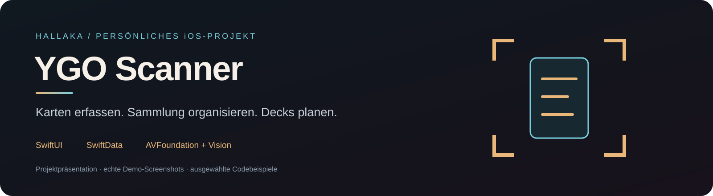
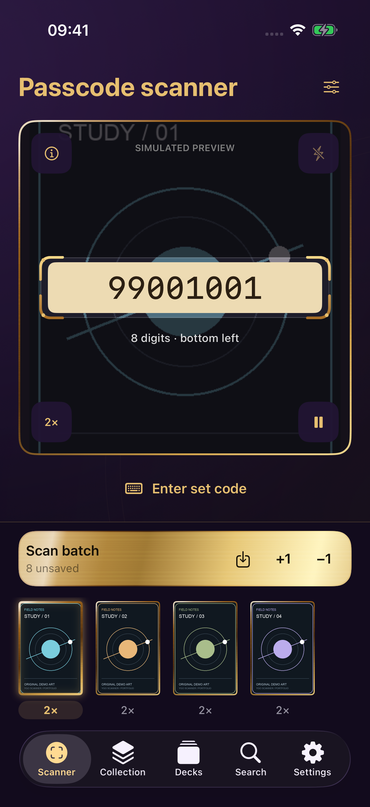
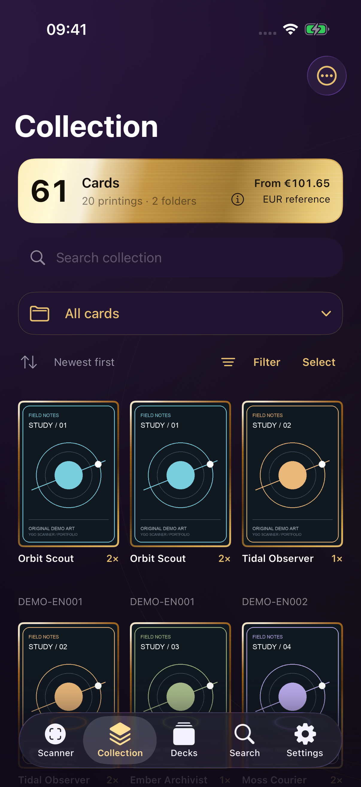
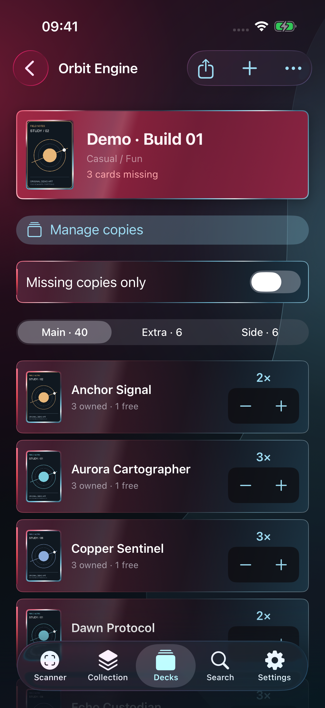

<a href="https://hallaka01.github.io/#ygo-scanner" title="View YGO Scanner in my portfolio"></a>

# YGO Scanner

A native iPhone companion for scanning cards, organizing a physical collection, and building decks around the copies I actually own.

**A personal project by [Hallaka01](https://github.com/Hallaka01)** · SwiftUI · SwiftData · AVFoundation · Vision · iOS 17+

**[View this project in my Neon City portfolio ↗](https://hallaka01.github.io/#ygo-scanner)**

## Inside the app

| Scanner | Millennium theme | Deck planning |
| :---: | :---: | :---: |
|  |  |  |

The **Millennium** theme pairs deep purple surfaces and gold frames with a card gallery. **Branded** uses crimson accents, pale blue highlights, and compact lists.

More views: [Branded collection](assets/screenshots/01-collection.png) · [Card details](assets/screenshots/03-card-detail.png) · [Missing copies](assets/screenshots/04-missing-cards.png) · [Scan review](assets/screenshots/05-scan-detail.png)

*Real app views with fictional demo cards. The scanner camera preview is simulated. [Screenshot notes](docs/SCREENSHOTS.md)*

## What it does

- **Scan and review:** Read card passcodes, confirm repeated observations, and collect scans in a draft batch before saving.
- **Track physical copies:** Keep printings, language, condition, folders, and deck assignments together.
- **Plan complete decks:** Manage Main, Extra, and Side; distinguish owned, available, and missing copies.
- **Keep data portable:** Export YDK decklists, XML reports, and JSON backups.

## Under the hood

SwiftUI handles the interface, AVFoundation and Vision handle camera recognition, and SwiftData stores the collection locally. Card data and images use separate caches.

Selected Swift extracts show [scan confirmation](Examples/ScannerCore/ScanRecognition.swift), [printing codes](Examples/ScannerCore/PrintingCode.swift), and [inventory availability](Examples/ScannerCore/DeckInventory.swift).

[Architecture](docs/ARCHITECTURE.md) · [Data model](docs/SCHEMA.md)

## Run the examples

Requires macOS 14+, Swift 5.9+, [just](https://github.com/casey/just), and [Lefthook](https://github.com/evilmartians/lefthook).

```sh
just setup
just check
just test
```

Ten tests cover ambiguous OCR, frame confirmation, brief recognition dropouts, printing codes, and copies assigned to other decks. GitHub Actions runs the same checks.

## About

This repository presents a personal app; the full application and collection data remain private. It contains standalone code examples, not an app download.

The app uses [YGOPRODeck](https://api.ygoprodeck.com/api-guide/) and [Yugipedia](https://yugipedia.com/) as data sources. This independent project is not affiliated with Konami. [Rights and usage](NOTICE.md)
